# PR0303: Parámetros en Bash

## 1. Calculadora básica

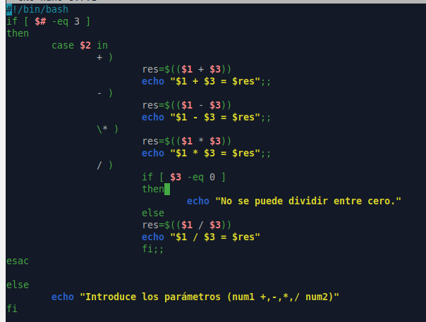

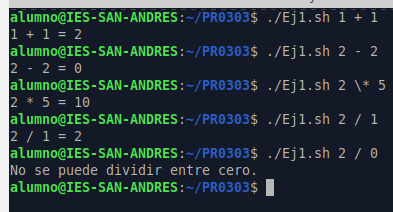

## 2. Validador de direcciones IP

## 3. Contador de archivos por tipo

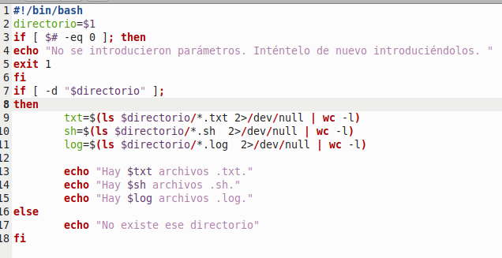

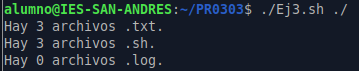

## 4. Backup de un directorio

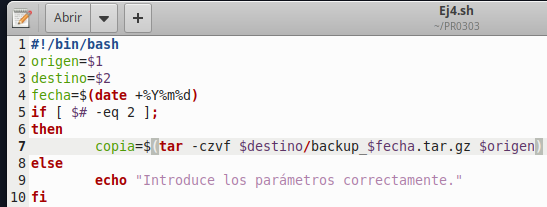

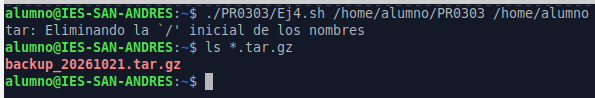

## 5. Conversor de temperatura (Celsius ⇄ Fahrenheit)

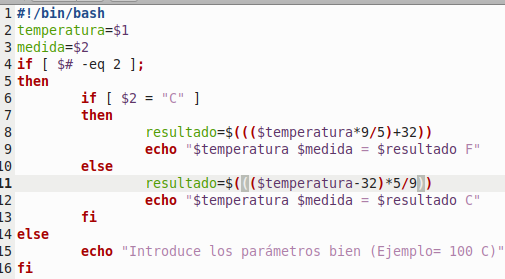

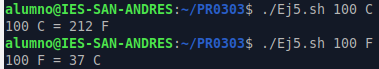

## 6. Generador de nombres de archivos aleatorios

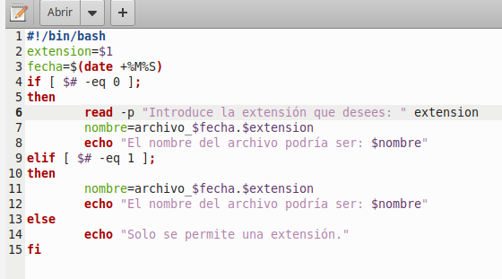

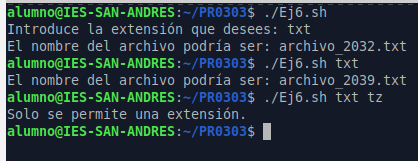

## 7. Script para comparar dos archivos

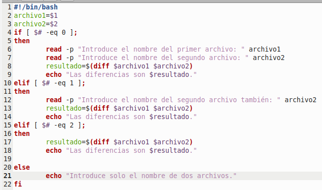

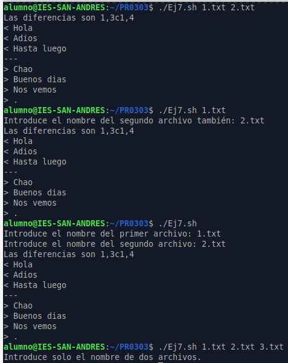