## 1. Menú de operaciones matemáticas

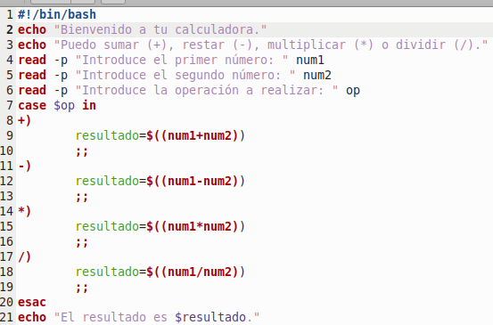

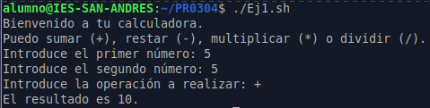

## 2. Verificar días de la semana

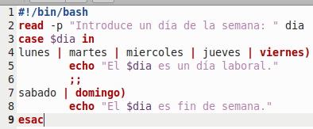

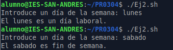

## 3. Clasificar calificaciones

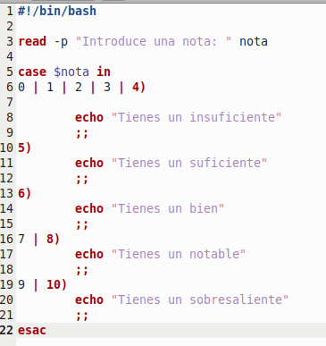

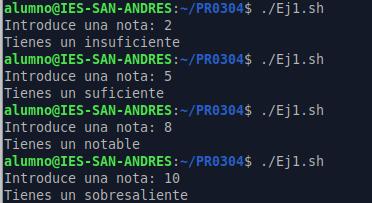

## 4. Determinar la estación del año

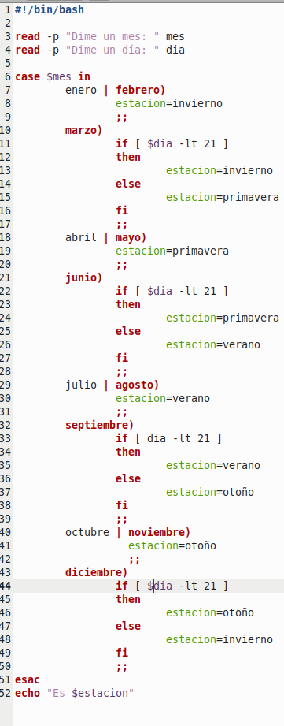

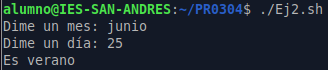

## 5. Extensión de archivo

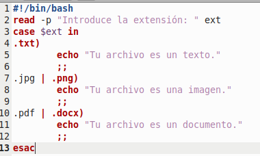

## 6. Convertir temperaturas

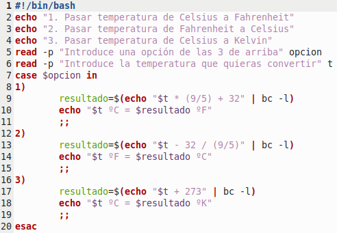

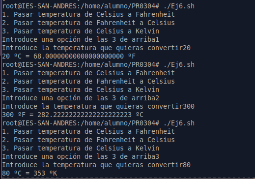

## 7. Modificar estado de un servicio

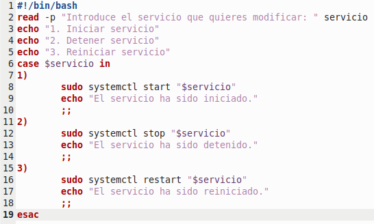

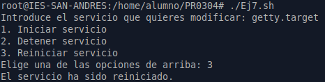

## 8. Convertir metros a distintas medidas

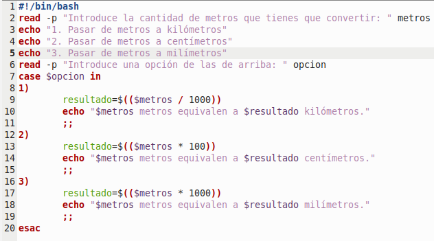

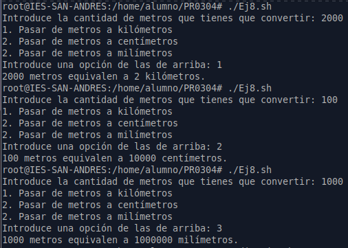