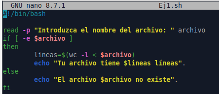
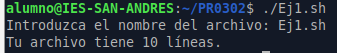

# PR0302 Condicional if

## 1. Escribe un script que solicite el nombre de un archivo y luego imprima cuántas líneas tiene ese archivo. Verifica que el archivo exista antes de contar las líneas.

## 2. Crea un script que compruebe si un archivo (cuya ruta pedirá al usuario por teclado) existe y si tiene permisos de lectura. Muestra un mensaje adecuado para cada caso.

