# Bloque 1: Inspección y selección de objetos (Get-Member y Select-Object)

## 1. Descubriendo tipos de objetos

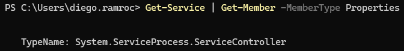

## 2. Explorando métodos y propiedades

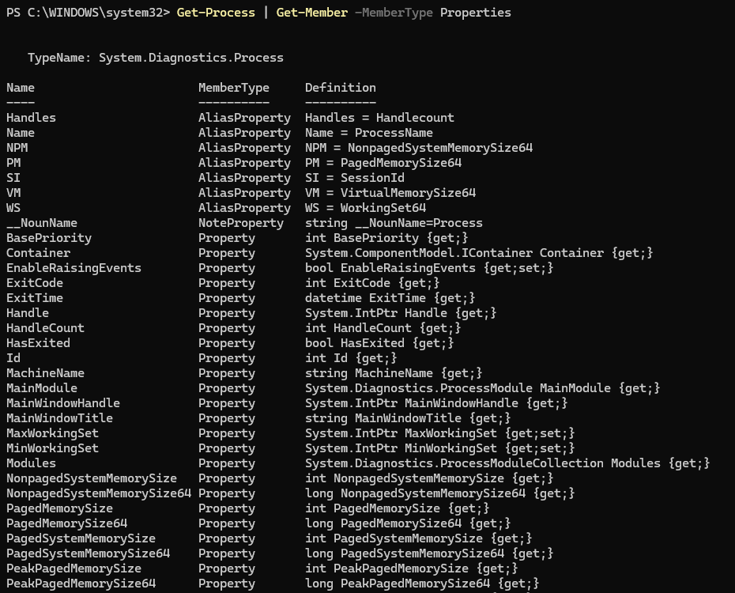

## 3. Acceso directo a propiedades

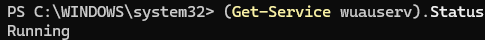

## 4. Selección de propiedades específicas

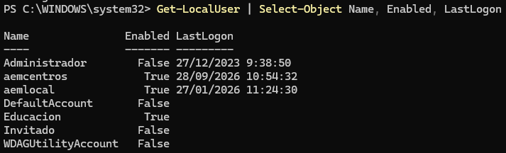

## 5. Inspección completa

# Bloque 2: Ordenación, agrupación y medición (Sort, Group, Measure)

## 1. Ordenación descendente

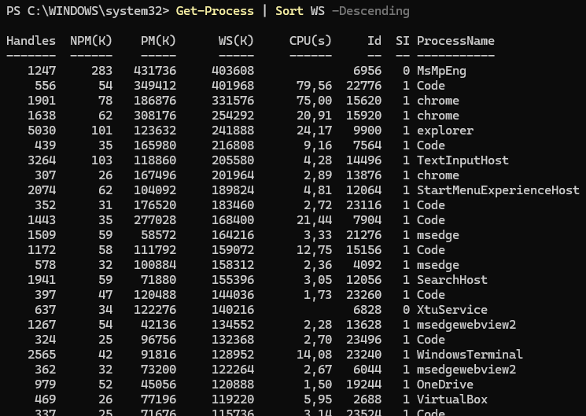

## 2. Auditoría de servicios con agrupación

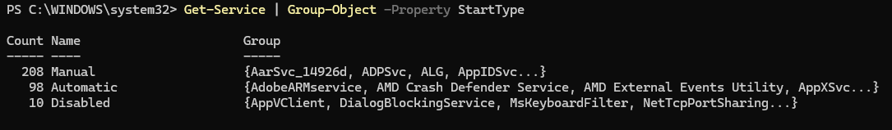

## 3. Agrupación por múltiples criterios

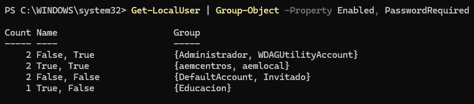

## 4. Estadísticas de ficheros

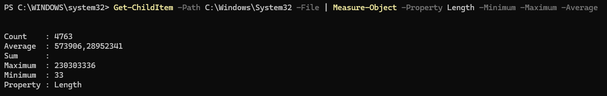

# Bloque 3: Filtrado de objetos (Where-Object)

## 1. Filtrado básico (Sintaxis moderna)

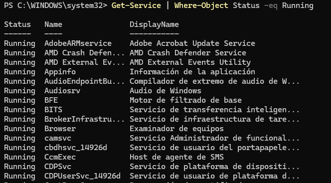

## 2. Filtrado clásico (Scriptblock)

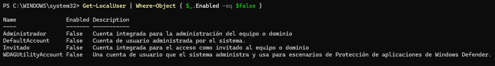

## 3. Filtrado con comodines

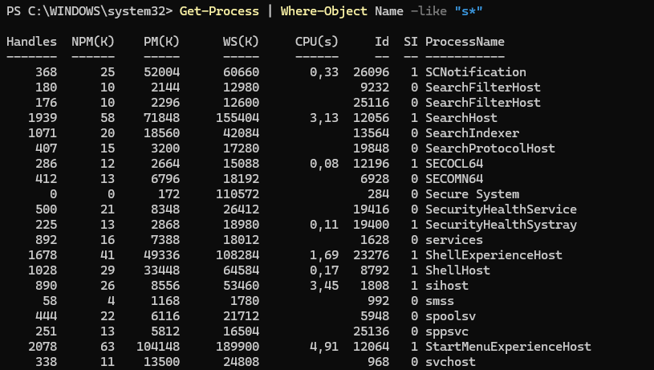

## 4. Filtrado numérico

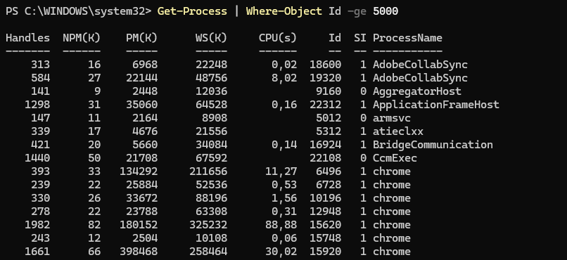

# Bloque 4: Formato de la salida

## 1. Vista panorámica en columnas

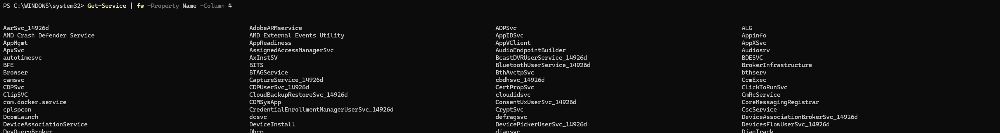

## 2. Tablas ajustadas

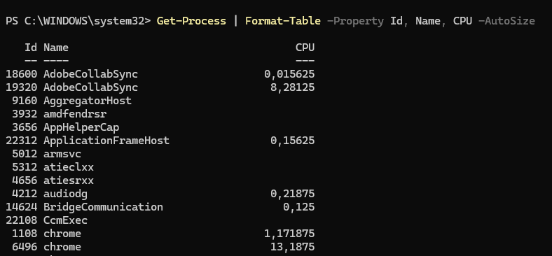

## 3. Vista detallada en lista

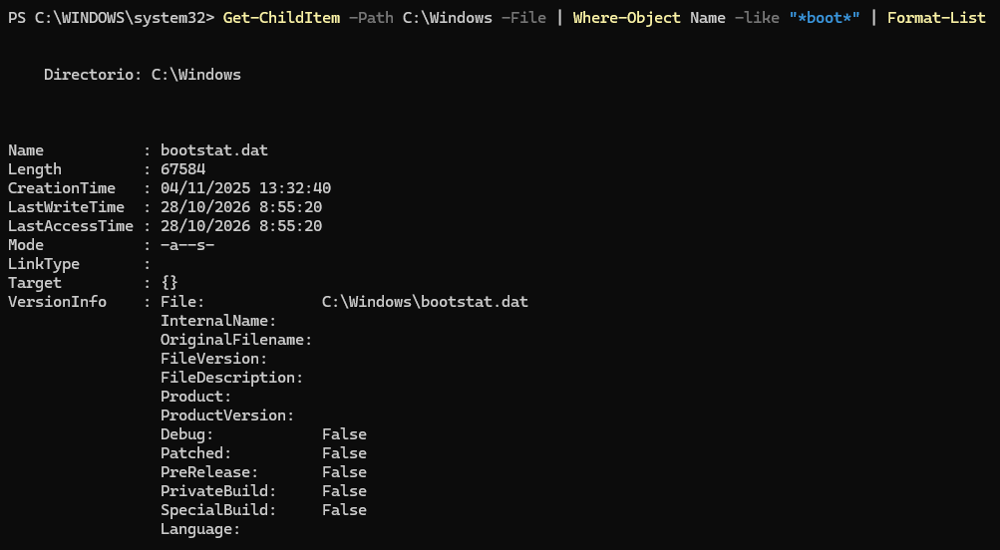