## Fase 1. Identificación, parentesco y jerarquía de procesos
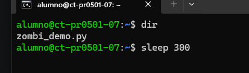
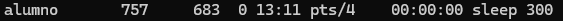
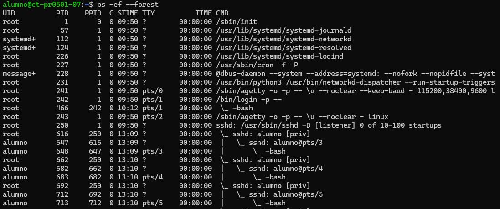
### ¿Cuál es el PID del proceso sleep y cuál es el PID de su proceso padre (PPID)? ¿A qué proceso corresponde ese padre?
#### El 757, y el PPID el 683. Corresponde a bash.
### Indica dos procesos del sistema que tengan ? en la columna TTY y explica qué significa.
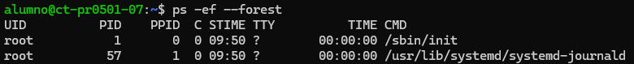
#### El init y el journald, llevan esa interrogación porque no tienen una bash asociada.
## Fase 2. Primer plano, segundo plano y control de trabajos
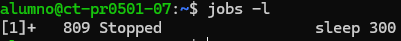
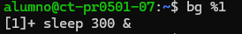
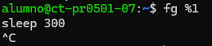
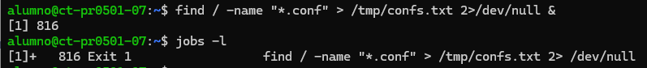
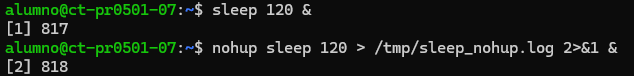
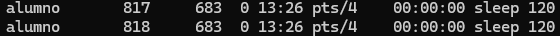
#### Al suspender con Ctrl + Z, STAT muestra T (detenido). Al ejecutar bg, el proceso se reanuda en segundo plano y su estado pasa a S (Sleeping, esperando a que termine el sleep) o R (Running).
#### nohup evita que el proceso muera al cerrar la terminal o la sesión. Se redirigen stdout y stderr a un archivo para no ensuciar ni bloquear la terminal con mensajes mientras trabajas, y para guardar un registro de los resultados y errores que puedas revisar luego.
## Fase 3. Monitorización en vivo y prioridades (top / htop, nice, renice)
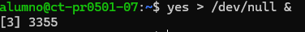
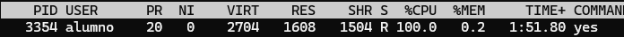
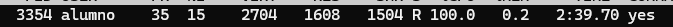
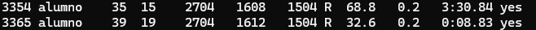
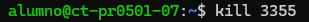
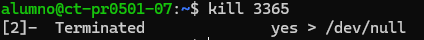
#### NI significa la prioridad que la CPU le está dando, si es baja pues la cpu le dará más prioridad.
#### Pone la R de Running.
## 4. Detección y limpieza de un proceso zombi (Z)
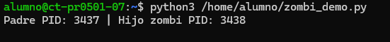
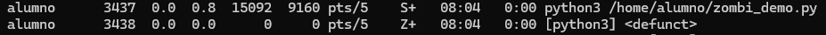

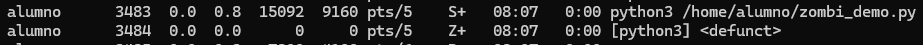
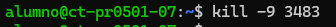
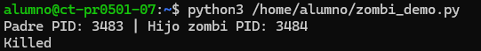
#### Al matar el proceso zombi, nunca se borrará porque el proceso padre lo ejecutará siempre de nuevo.
#### Cuando matamos el proceso padre, el zombi también muere debido a la dependencia a ese proceso, sin el padre no puede ejecutarse.
## Fase 5. Verificación y limpieza final
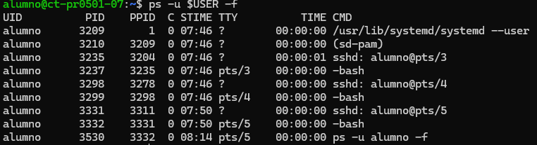
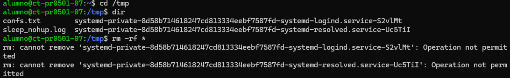
